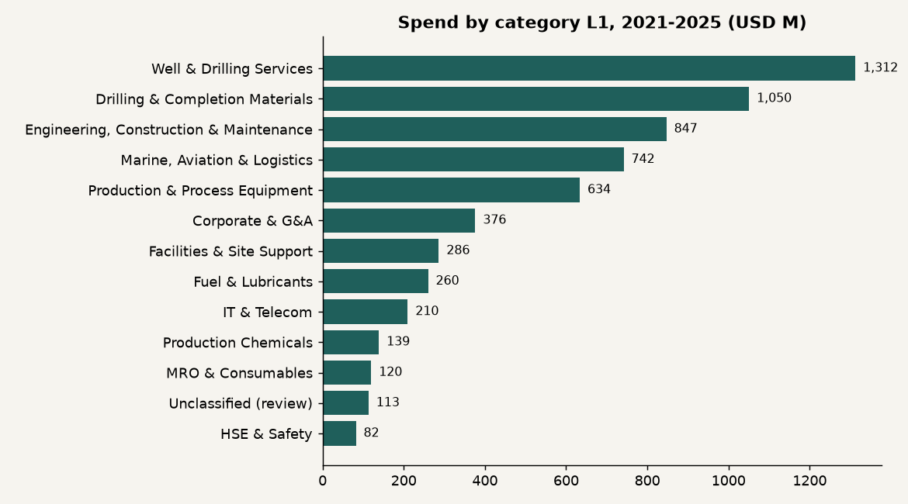
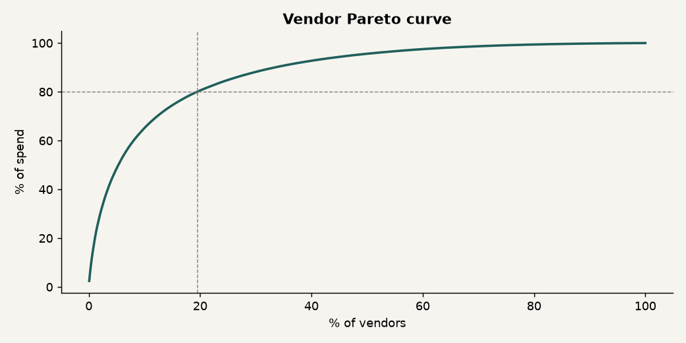
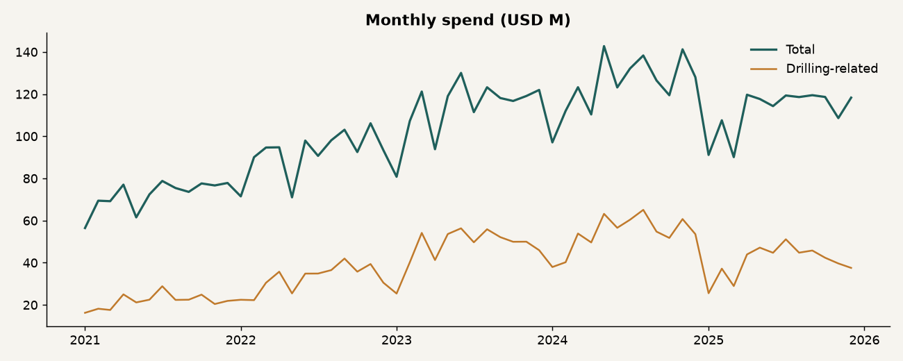

# Procurement Spend Cube & PO Line Auto-Classification (Upstream Oil & Gas)

**Client:** Indonesian upstream oil & gas operator (name withheld) · **Role:** Procurement / data analyst
**Scope:** 855,300 PO lines, 322k purchase orders, 1,383 vendor IDs, USD 6.2B spend (2021–2025)
**Stack:** Python (pandas, scikit-learn), Jupyter, HTML/SVG dashboard (GitHub Pages)

**Live dashboard:** https://brmsyh.github.io/og-procurement-spend-cube/



## The problem

Category managers could not answer basic questions such as *"How much do we spend on valves, and with how many vendors?"*

- Only **46.9%** of PO lines carried a category. About **1 in 10** of those labels was wrong.
- Item descriptions were free text, mixing English and Bahasa Indonesia, with abbreviations and typos (`GATE VLV 4" CL300 WCB`, `Jasa penyemenan SKT-12 casing 9-5/8"`).
- The vendor master held the same legal entity under several IDs (`PT Sinar Baja Teknik` vs `SINAR BAJA TEKNIK, PT`).

## What I built

1. **Cleaning.** Removed duplicate extract rows and zero-value lines, normalised plant and currency codes, and reconciled USD values against monthly IDR/USD rates.
2. **Vendor normalisation.** Grouped vendor IDs by tax ID and picked one golden record per group: **1,383 vendor IDs → 1,311 legal entities**.
3. **Auto-classification.** Built a 50-category, 3-level taxonomy aligned to UNSPSC. Every line was classified with TF-IDF character and word n-grams and a calibrated linear SVM, trained on the existing (noisy) buyer labels.
   - Lines with confidence **≥ 0.20** take the model's category.
   - Lines below that keep the buyer label if they have one. Otherwise they go to a **manual review queue**.
   - Where the model is confident (≥ 0.60) and disagrees with the buyer label, the line is flagged as a likely mislabel.
4. **Spend cube** (category × vendor × site × year) and the analyses category managers asked for: Pareto and tail spend, vendor fragmentation, contract coverage, local vs foreign share, seasonality, and price dispersion on identical items.
5. **Dashboard** for the procurement leadership team (`docs/index.html`).

## Results

| Metric | Before | After |
|---|---|---|
| PO lines with a category | 46.9% | **92.8%** (98.2% of spend) |
| Category accuracy on 2,000 lines validated by category managers | 90.6% (buyer labels) | **99.5%** (auto-assigned lines) |
| Vendor records | 1,383 IDs | **1,311 entities** (72 duplicates, USD 97M re-attributed) |

## Key findings

- **Concentration:** 255 of 1,311 vendors (19%) carry 80% of spend. The last 5% of spend is spread over 689 vendors.
- **Fragmentation:** process-equipment and MRO categories use 220–439 vendors each, while 19–32 vendors cover 80% of their spend.
- **Contract coverage:** material categories are only 15–16% on contract, against ~75% for major services.
- **Price dispersion:** where the same material code was bought from 2+ vendors in the same year, prices above each item's P25 add up to USD 108M. That is an upper bound; a realistic 20–30% capture through framework tenders gives **USD 22–32M** over 5 years.
- **Year-end flush:** 21.7% of indirect/MRO spend is placed in Nov–Dec.
- **Process gaps:** 61k lines (USD 113M) carry vague descriptions such as "sesuai penawaran" or "lihat lampiran". A required, structured description field would close this gap.

The full findings and recommendations table is at the end of the notebook.




## Repository layout

```
├── data/
│   ├── raw/                 category_taxonomy.csv, vendor_master.csv, fx_rates_monthly.csv, qa_validated_sample.csv
│   └── sample/              po_lines_sample_20k.csv  (20k-row sample of the PO extract)
├── docs/                    index.html (dashboard), dashboard_data.json
├── notebooks/               spend_cube_analysis.ipynb  (executed, with outputs)
├── outputs/figures/         charts used in this README
└── src/
    ├── taxonomy.py          category taxonomy (L1 > L2 > L3, UNSPSC codes)
    ├── generate_data.py     rebuilds the full PO extract (seeded)
    ├── build_notebook.py    builds the notebook
    └── build_dashboard.py   writes docs/index.html from the notebook output
```

## How to run

```bash
pip install pandas numpy scikit-learn matplotlib pyarrow jupyter
python src/generate_data.py          # writes data/raw/po_lines_2021_2025.csv (~180 MB, 855k rows)
jupyter nbconvert --to notebook --execute --inplace notebooks/spend_cube_analysis.ipynb
python src/build_dashboard.py
```

The full PO extract is too large for the repository, so `generate_data.py` rebuilds it deterministically. A 20k-row sample is included in `data/sample/` for a quick look.

## Data note

The client's data is confidential. This repository runs on a synthetic replica that matches the original extract's structure (SAP PO-line fields), volumes, category mix and data-quality issues. No client records, names or prices are included.
